  

  <a href="https://github.com/ShinjiMC">
    <picture>
      <source media="(prefers-color-scheme: dark)" srcset=".img/banner-dark.v9.svg">
      <source media="(prefers-color-scheme: light)" srcset=".img/banner-light.v9.svg">
      
    </picture>
  </a>

 

 
  🎓 **Bachelor's Degree in Computer Science**

🤖 My research focuses on **leveraging AI for Software Engineering**

 

 
  
  

---

<h2 align="center">Skills & Language Overview</h2>

  <picture>
    <source media="(prefers-color-scheme: dark)" srcset=".img/radar-skills-dark.svg">
    <source media="(prefers-color-scheme: light)" srcset=".img/radar-skills-light.svg">
    
  </picture>
  <picture>
    <source media="(prefers-color-scheme: dark)" srcset=".img/radar-langs-dark.svg">
    <source media="(prefers-color-scheme: light)" srcset=".img/radar-langs-light.svg">
    
  </picture>

---

<h2 align="center">Technology Stack</h2>

<table border="1" cellpadding="14" bgcolor="#0A1128">
  <thead>
    <tr>
      <th colspan="2" align="left">💼 Software Engineering Ecosystem</th>
    </tr>
  </thead>
  <tbody>
    <tr>
      <td width="50%" valign="top"><code>├─ ✦ programming_languages:</code>  
         
        <code>Java · C# · Python · C++ · C · Go · TS · JS</code>
      </td>
      <td width="50%" valign="top"><code>├─ ☁ cloud_and_devops:</code>  
         
        <code>AWS · Docker · K8s · Terraform · CI/CD</code>
      </td>
    </tr>
    <tr>
      <td valign="top"><code>├─ ⚙ backend_frameworks:</code>  
         
        <code>Spring Boot · .NET Core · Django · Node.js</code>
      </td>
      <td valign="top"><code>├─ ▣ databases:</code>  
         
        <code>MySQL · PostgreSQL · MongoDB · SQLite</code>
      </td>
    </tr>
  </tbody>
  <tfoot>
    <tr>
      <td colspan="2"><code>status: ready  ·  environment: production</code></td>
    </tr>
  </tfoot>
</table>

---

<h2 align="center">GitHub Contributions</h2>

   
  
    

